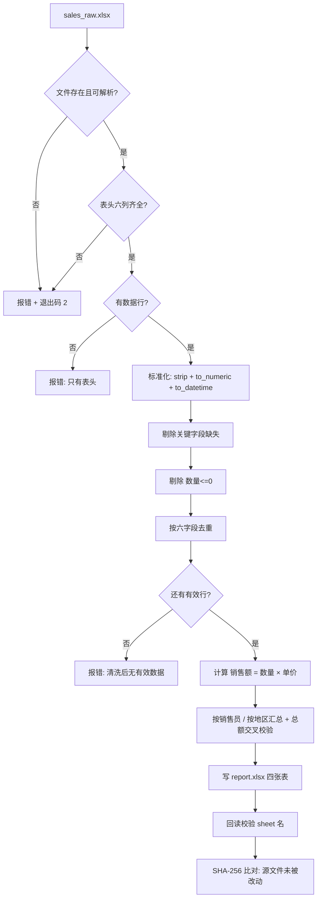
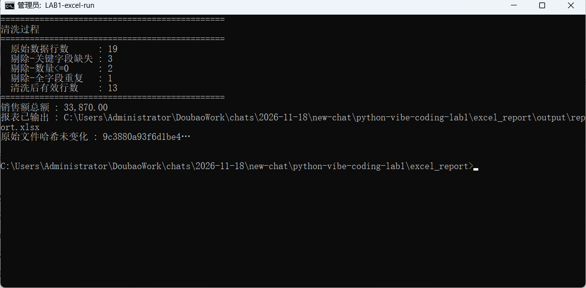
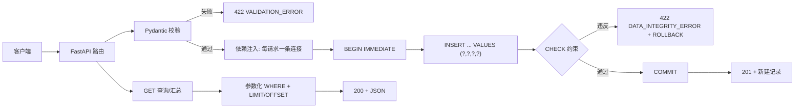
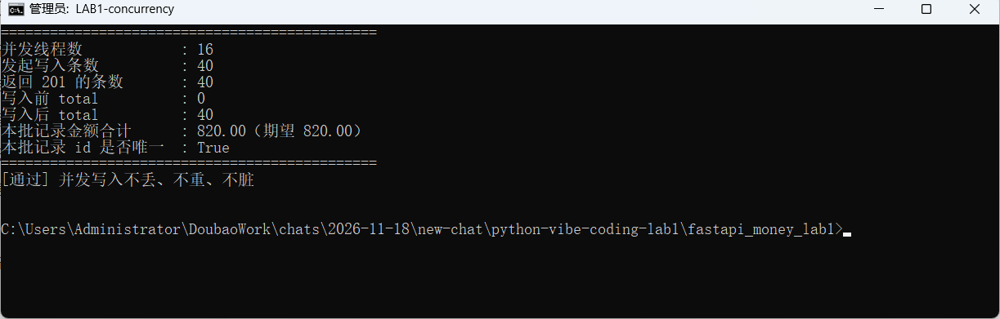
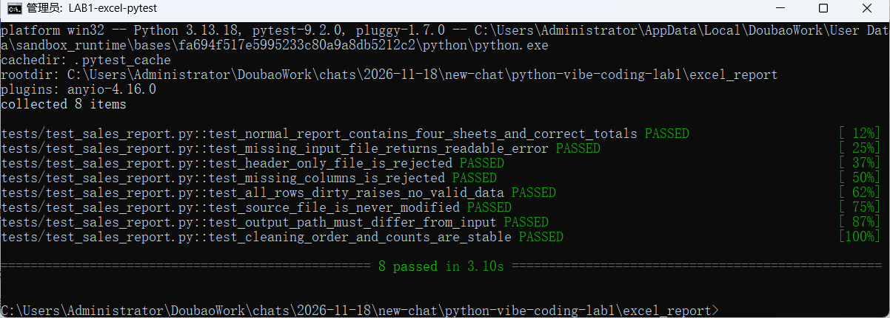
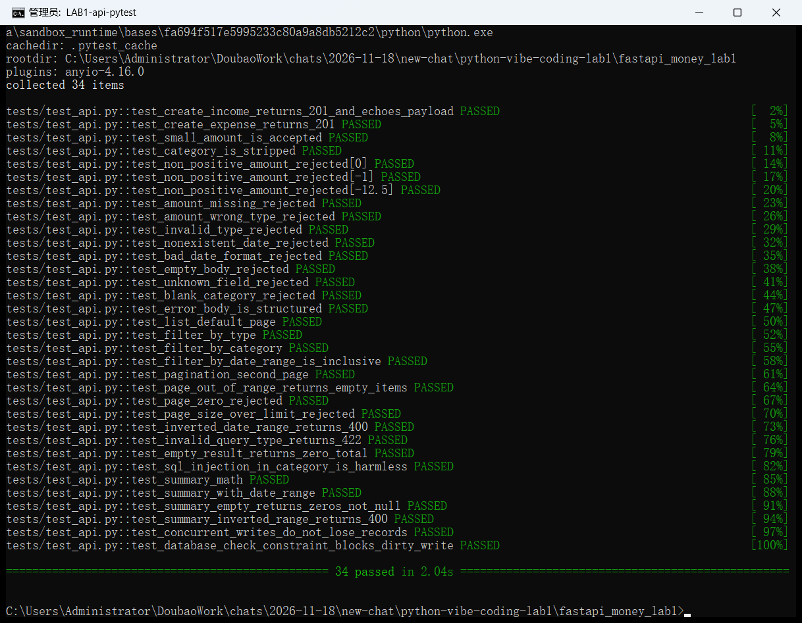
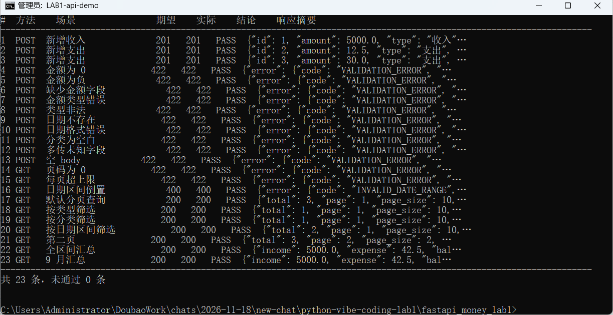

# Python Vibe Coding 实操复盘：从需求澄清到可验证交付

> 一次限时 60 分钟的机考，两个考题：**Excel 脏数据报表（必做 40 分）** + **FastAPI 记账接口**。
> 这篇文章不复述"AI 帮我写了什么"，而是记录**我是怎么管住 AI 的**：需求怎么澄清、任务怎么拆、每步怎么验、风险怎么审查、最后怎么复盘。

仓库地址：[https://github.com/Hanna2126/python-vibe-coding-lab1](https://github.com/Hanna2126/python-vibe-coding-lab1)（代码 + 样例数据 + 测试全在里面）

---

## 〇、这个实验到底在考什么

考题说明里有句话定调：

> 核心不在于"会不会手写代码"，而在于能否把需求讲清楚、把任务拆得开、把过程管得住、把结果验得出。

评分是五维的：**结果 + 过程 + 验证 + 风险 + 复盘**。而且明确写了"仅让 AI 生成、跑通就交"按初级用法处理，过程分上限受限。

所以我在动手之前先给自己定了一条纪律：

> **凡是我没写进需求清单的东西，AI 写出来我一律不认。**

这条纪律后面救了我很多次——尤其是"金额到底能不能等于 0""无数据汇总该返回 0 还是 null"这种看起来很小、但会直接决定验收对错的点。

---

## 一、先别让 AI 写代码：需求澄清清单

我把两份澄清清单写在交给 AI 之前（`需求澄清与复盘.md` 里留了全文）。这里挑关键的说。

### 1.1 考题一：清洗口径必须写死，不能"看着办"

脏数据的处理最怕"AI 自己拿主意"。比如"关键字段"到底指哪几个字段？如果我只写"删除关键字段缺失的行"，AI 大概率只删 `日期` 和 `数量` 为空的，`单价` 空的行会被留下，然后 `数量 × 单价` 变成 NaN，汇总直接错。

所以我把它写成一张**口径表**：

| 项 | 我定的口径 |
| --- | --- |
| 关键字段 | 日期、销售员、产品、数量、单价、地区，**六列任一为空即整行剔除** |
| 空值判定 | 纯空格也算空（要先 `strip()` 再判 NA） |
| 数量异常 | `数量 <= 0` 剔除（0 单、负数、测试数据全归这里） |
| 去重 | **六字段全一致**才算重复，保留首次出现 |
| 销售额 | `数量 × 单价`，保留两位小数 |
| 输出 | 四张表：明细清洗后 / 按销售员 / 按地区 / 总览 |
| 只读 | 运行前后对源文件做 SHA-256 比对，不一致直接报错 |

清洗顺序也是我拍的：**缺失 → 数量 → 去重**。顺序看着无所谓，其实会改变每一类剔除的计数，也会改变"重复行里保留哪一条"。写进清单，AI 就不会自己换顺序。

### 1.2 考题二：把接口写成契约表

接口类的需求，最有效的澄清方式是**把请求、响应、状态码三件事列成表**：

| 方法 | 路径 | 关键参数 | 成功 | 失败 |
| --- | --- | --- | --- | --- |
| POST | `/records` | `amount > 0`、`type ∈ {收入,支出}`、`date` 真实存在、`category` 非空白 | 201 + 记录 | 422 |
| GET | `/records` | `type / category / date_from / date_to / page / page_size` | 200 + `{total,page,page_size,items}` | 400 / 422 |
| GET | `/summary` | `date_from / date_to` | 200 + `{income,expense,balance}` | 400 / 422 |

再补三条**状态码归属**的约定，这条最容易含糊：

- **422** = 参数本身不合法（金额 ≤ 0、类型不在枚举、日期不存在、page < 1、page_size > 100）；
- **400** = 参数各自合法但组合违反业务规则（`date_from > date_to`）；
- **201** = 创建成功，且响应体里回显新建记录（不只是返回一个 id）。

还有一条容易被忽略的：**多传未知字段怎么办**。我选了"直接 422"（`extra="forbid"`），因为静默忽略字段比报错更危险——调用方会以为字段写进去了。

---

## 二、把大需求拆成可验证的小步

"一步到位让 AI 写完整个项目"在我这里是不允许的。两个考题我都拆成 6 步，每一步都带**验证动作**。

### 2.1 考题一

| 步骤 | 让 AI 做什么 | 我做什么 | 验证 |
| --- | --- | --- | --- |
| 1 | 生成 19 行脏样例 | 手算期望总额 33 870.00 作基准 | 三类脏数据各若干行 |
| 2 | 读取 + 表头校验 | 确认缺列/空表报什么错 | 5 个异常用例 |
| 3 | 清洗流水线 | 拍板清洗顺序 | 计数 3 / 2 / 1，有效 13 行 |
| 4 | 三维度汇总 | 核对"销售员合计 = 地区合计 = 总额" | 三个数都是 33 870.00 |
| 5 | 四表输出 + 样式 | 查 sheet 名、金额格式、合计行 | 打开文件逐表核对 |
| 6 | 补 pytest + 只读校验 | 加 SHA-256 前后比对 | 8 个用例通过 |

### 2.2 考题二

| 步骤 | 让 AI 做什么 | 我做什么 | 验证 |
| --- | --- | --- | --- |
| 1 | 目录骨架 + `main.py` | 确认 `uvicorn` 能起、`/docs` 能开 | 启动成功 |
| 2 | Pydantic 模型 | 审 `amount>0`、枚举、日期真实性 | 校验用例 |
| 3 | POST + SQLite 写入 | 审事务、回滚、201 回显 | 正常/非法金额/非法类型 |
| 4 | GET 筛选 + 分页 | 审参数化、分页边界 | 空结果/page=0/超限 |
| 5 | GET /summary | 审区间边界、空数据返 0 | 有数据/无数据/区间倒置 |
| 6 | 并发方案 | 确认 WAL + busy_timeout + CHECK | 16 线程并发 40 条不丢 |

拆小步最大的好处不是"AI 写得更好"，而是**每一步我都能独立判定对错**。第 3 步错了不会污染第 4 步的结论，定位成本极低。

---

## 三、考题一：Excel 报表脚本

### 3.1 脏数据长什么样

样例数据我特意做成 19 行，其中 6 行是脏的：

| 脏数据类型 | 行数 | 例子 |
| --- | --- | --- |
| 关键字段缺失 | 3 | 日期空 1 行、销售员空 1 行、单价空 1 行 |
| 数量异常 | 2 | 数量 `0`、数量 `-3` |
| 全字段重复 | 1 | 与第 1 行一模一样 |

剩下 13 行有效，销售额总额 **33 870.00 元**。这个数是我先手算出来的，不是跑完再看结果——**先有期望值，才有验证**。

### 3.2 清洗流水线



流程图里有两个地方是"需求清单里没有、但我坚持要加"的：**总额交叉校验**和**回读校验**。前者防"聚合写错却没人发现"，后者防"文件写出去了但打不开"。

### 3.3 关键代码

**标准化：先把脏值变成"可判定的缺失"，再统一处理**

```python
# 1) 文本列去首尾空白，空白串统一成缺失值，防止 " " 混进有效数据
for col in ("日期", "销售员", "产品", "地区"):
    work[col] = work[col].astype("string").str.strip().replace("", pd.NA)

# 2) 数值与日期强制转类型：转不动的变成 NaN/NaT，等价于"脏值"，交给缺失规则处理
work["数量"] = pd.to_numeric(work["数量"], errors="coerce")
work["单价"] = pd.to_numeric(work["单价"], errors="coerce")
work["日期"] = pd.to_datetime(work["日期"], errors="coerce", format="mixed")
```

这里有个细节：`errors="coerce"` 把 `"abc"` 这种非数字变成 `NaN`，于是"数量写成文字"的行会自动落进"关键字段缺失"里被剔除，**不会让整批数据崩掉**。这就是考题要求的"异常输入不崩溃且有可读提示"。

**清洗顺序（每一步都计数，能对账）**

```python
mask_missing = work[KEY_COLUMNS].isna().any(axis=1)
stats.dropped_missing = int(mask_missing.sum())
work = work.loc[~mask_missing]

mask_bad_qty = work["数量"] <= 0
stats.dropped_bad_qty = int(mask_bad_qty.sum())
work = work.loc[~mask_bad_qty]

rows_before_dedup = len(work)
work = work.drop_duplicates(keep="first")
stats.dropped_dup = rows_before_dedup - len(work)
```

为什么要逐类计数？因为报告里要写"剔除了 6 行"，我必须能说清这 6 行分别是哪几类，而不是一句"清洗完成"。

**汇总 + 占比**

```python
grouped = (
    detail.groupby(dimension, as_index=False)
    .agg(销售额=("销售额", "sum"), 订单数=("销售额", "count"))
    .sort_values(["销售额", dimension], ascending=[False, True])
    .reset_index(drop=True)
)
total = round(float(grouped["销售额"].sum()), 2)
grouped["占比"] = (grouped["销售额"] / total).round(4) if total else 0.0
```

**防止"静默算错"的三处总额一致性断言**

```python
if abs(seller_total - total) > 0.01 or abs(region_total - total) > 0.01:
    raise ReportError(
        f"汇总校验失败：明细总额 {total}，按销售员 {seller_total}，按地区 {region_total}，请检查聚合逻辑"
    )
```

**只读约束怎么"证明"**

```python
source_hash = sha256_of(input_path)
...
if sha256_of(input_path) != source_hash:
    raise ReportError("原始文件内容在运行过程中被改动，违反只读约束，请立即排查")
```

考题只写"不得修改原始文件"。我把它从"我应该不会改"变成"**我能证明没改**"。顺带还拦了一个坑：输出路径等于输入路径时直接拒绝，避免一次手滑把源文件覆盖掉。

### 3.4 运行结果

```text
==============================================
清洗过程
==============================================
  原始数据行数      : 19
  剔除-关键字段缺失 : 3
  剔除-数量<=0      : 2
  剔除-全字段重复   : 1
清洗后有效行数    : 13
==============================================
销售额总额 : 33,870.00
报表已输出 : ...\excel_report\output\report.xlsx
原始文件哈希未变化 : 10390e6d6e50dda6…
```



四张表的内容（`按销售员` / `按地区` 我都加了合计行）：

| 销售员 | 销售额 | 订单数 | 占比 |
| --- | --- | --- | --- |
| 张三 | 13 200.00 | 3 | 38.97% |
| 李四 | 9 600.00 | 3 | 28.34% |
| 赵六 | 6 170.00 | 4 | 18.22% |
| 王五 | 4 900.00 | 3 | 14.47% |
| 合计（4 个销售员） | **33 870.00** | 13 | 100.00% |

| 地区 | 销售额 | 订单数 | 占比 |
| --- | --- | --- | --- |
| 华东 | 12 400.00 | 2 | 36.61% |
| 华南 | 10 400.00 | 4 | 30.71% |
| 西南 | 6 170.00 | 4 | 18.22% |
| 华北 | 4 900.00 | 3 | 14.47% |
| 合计（4 个地区） | **33 870.00** | 13 | 100.00% |

**人工核对的过程**（这一步必须手算，不能信脚本）：

- 张三：`2×5000 + 10×80 + 2×1200 = 10000 + 800 + 2400 = 13 200` ✅
- 李四：`3×1200 + 5×200 + 2×2500 = 3600 + 1000 + 5000 = 9 600` ✅
- 赵六：`1×5000 + 4×80 + 2×200 + 3×150 = 5000 + 320 + 400 + 450 = 6 170` ✅
- 王五：`1×2500 + 8×150 + 6×200 = 2500 + 1200 + 1200 = 4 900` ✅
- 合计：`13200 + 9600 + 6170 + 4900 = 33 870` ✅，与两个维度的合计行完全一致。

`总览` 表还额外给了脏数据占比 31.58%、客单价 2 605.38 元、最高销售额销售员（张三 13 200.00）、数据日期区间 2026-09-01 ~ 2026-09-28。这些指标不是考题要求的，但一份给团队看的报表，只有"总额"一个数字是不够的。

---

## 四、考题二：FastAPI 记账服务

### 4.1 为什么要分层

一个 3 个接口的服务，很多人会写进一个 `main.py`。我没这么做，因为**过程可控的前提是"能改得动"**：

```
fastapi_money_lab1/
├── app/
│   ├── main.py          # 入口：lifespan 建库、挂路由
│   ├── database.py      # 连接、WAL、busy_timeout、CHECK 约束
│   ├── schemas.py       # Pydantic 校验规则（规则只写一处）
│   ├── errors.py        # 结构化错误体 + 全局异常处理
│   ├── validators.py    # 跨路由业务校验（日期区间）
│   └── routers/
│       ├── records.py   # POST /records、GET /records
│       └── summary.py   # GET /summary
├── tests/               # 每个用例一份独立临时库
└── tools/               # 接口实测 + 并发压测
```

好处很直接：改校验规则只动 `schemas.py`，改错误体只动 `errors.py`，AI 每次只碰一个小文件，我 review 的范围也就一小块。

### 4.2 请求全流程



### 4.3 校验规则集中在一处

```python
class RecordCreate(BaseModel):
    model_config = ConfigDict(extra="forbid", str_strip_whitespace=True)

    amount: float = Field(gt=0, allow_inf_nan=False, description="金额，必须大于 0")
    type: MoneyType = Field(description="类型：收入 / 支出")
    category: str = Field(min_length=1, max_length=32, description="分类，如 餐饮、工资")
    date: DateType = Field(description="记账日期，ISO 格式 YYYY-MM-DD")
```

三个我特意确认过的点：

1. `gt=0` 而**不是** `ge=0`。考题写"金额>0"，0 元流水没有业务意义，`ge=0` 会让考核用例直接挂。
2. `date: DateType` 用的是真日期类型，于是 `2026-02-30` 这种"格式对、日期不存在"的值会被自动拒绝——**不用自己写闰年判断**。
3. `extra="forbid"`：多传字段直接 422。

### 4.4 结构化错误体：一个壳包住所有失败

```python
def error_body(code: str, message: str, detail: Any = None) -> dict[str, Any]:
    return {"error": {"code": code, "message": message, "detail": detail}}
```

`detail` 只保留 `loc / msg / type` 三个字段，**不回传输入原文**，也不带任何堆栈信息。这一点是人工审查时加的：默认的 FastAPI 422 响应会把 `input` 原值回显，日志和响应体里都可能出现用户的敏感数据。

实测的 422 长这样：

```json
{"error": {
  "code": "VALIDATION_ERROR",
  "message": "请求参数校验失败，请检查字段类型与取值范围",
  "detail": [{"loc": ["body","amount"], "msg": "Input should be greater than 0", "type": "greater_than"}]
}}
```

### 4.5 写入：显式事务 + 双层拦截

```python
try:
    conn.execute("BEGIN IMMEDIATE")
    cursor = conn.execute(INSERT_SQL, (payload.amount, payload.type, payload.category, payload.date.isoformat()))
    new_id = int(cursor.lastrowid or 0)
    conn.execute("COMMIT")
except sqlite3.IntegrityError as exc:
    _safe_rollback(conn)
    raise ApiError(422, "DATA_INTEGRITY_ERROR", "数据未通过数据库约束校验（应用层已拦截，此处为兜底）", str(exc))
```

数据库层的约束是第二道闸：

```sql
amount   REAL NOT NULL CHECK (amount > 0),
type     TEXT NOT NULL CHECK (type IN ('收入', '支出')),
category TEXT NOT NULL CHECK (length(trim(category)) > 0),
date     TEXT NOT NULL CHECK (length(date) = 10),
```

为什么要两层？因为**应用层校验是可以被绕过的**——别的脚本直连数据库、以后加的批量导入接口、或者哪天有人把校验逻辑改坏了。有 CHECK 在，脏数据写不进去。我专门写了个测试直接绕过 API 插 `-5` 元，验证 `IntegrityError` 确实抛出（`test_database_check_constraint_blocks_dirty_write`）。

### 4.6 并发：不靠"我觉得没问题"

SQLite 的并发问题就两句话：**写锁是独占的，读在 WAL 下不阻塞写**。我的方案是四条：

| 措施 | 作用 |
| --- | --- |
| `PRAGMA journal_mode = WAL` | 读写不互斥，查询不被写事务阻塞 |
| `PRAGMA busy_timeout = 5000` | 抢不到写锁时最多等 5 秒，而不是立刻 500 |
| 每请求一条连接、用完即关 | 不跨请求持有事务，避免长事务把锁拖住 |
| `BEGIN IMMEDIATE` + `COMMIT/ROLLBACK` | 显式拿写锁，异常一律回滚，不留半条数据 |

实测（`tools/concurrency_check.py`，16 线程同时 POST 40 条）：

```text
并发线程数            : 16
发起写入条数          : 40
返回 201 的条数       : 40
写入前 total          : 0
写入后 total          : 40
本批记录金额合计      : 820.00（期望 820.00）
本批记录 id 是否唯一  : True
[通过] 并发写入不丢、不重、不脏
```



金额合计能对上（1+2+…+40 = 820），id 无重复，说明既没丢也没重。

### 4.7 汇总：无数据返回 0，不是 null

```sql
SELECT
    COALESCE(SUM(CASE WHEN type = '收入' THEN amount END), 0) AS income,
    COALESCE(SUM(CASE WHEN type = '支出' THEN amount END), 0) AS expense
FROM records
```

`SUM` 在空集上返回 `NULL`，套一层 `COALESCE(..., 0)` 才是 0。这条是人工拍板的：前端拿到 `null` 就要多做一次空值判断，而"没有数据"和"金额为 0"在业务上是同一件事。

---

## 五、验证：不截图，给可复现的输出

### 5.1 考题一：8 个用例

```text
tests/test_sales_report.py::test_normal_report_contains_four_sheets_and_correct_totals PASSED
tests/test_sales_report.py::test_missing_input_file_returns_readable_error PASSED
tests/test_sales_report.py::test_header_only_file_is_rejected PASSED
tests/test_sales_report.py::test_missing_columns_is_rejected PASSED
tests/test_sales_report.py::test_all_rows_dirty_raises_no_valid_data PASSED
tests/test_sales_report.py::test_source_file_is_never_modified PASSED
tests/test_sales_report.py::test_output_path_must_differ_from_input PASSED
tests/test_sales_report.py::test_cleaning_order_and_counts_are_stable PASSED

8 passed in 3.09s
```

覆盖了：正常生成（含金额断言）、文件缺失、只有表头、表头缺列、全是脏数据、源文件只读、输出覆盖输入、清洗计数稳定。



### 5.2 考题二：34 个用例

```text
34 passed, 1 warning in 2.07s
```



按类别拆：

| 类别 | 数量 | 例子 |
| --- | --- | --- |
| 正常写入 | 4 | 收入/支出/0.01 元/分类自动去空格 |
| 参数校验 422 | 11 | 金额 0、负数、缺失、类型错、`2026-02-30`、`2026/9/30`、空 body、未知字段、空白分类、page=0、page_size=101 |
| 查询与分页 | 9 | 默认分页、类型筛选、分类筛选、区间含端点、第二页不重叠、越界空列表、区间倒置 400、空结果 |
| 汇总 | 4 | 加减正确、区间汇总、空数据返 0、区间倒置 400 |
| 安全/一致性 | 3 | SQL 注入字符串无害、并发 24 条不丢、CHECK 约束拦截 |

### 5.3 接口实测：23 条逐条比对

我不满足于 pytest，又写了个 `tools/api_demo.py`，把"期望状态码"和"实际状态码"打在一张表里：

```text
#  方法    场景                期望    实际    结论
1  POST  新增收入              201   201   PASS
4  POST  金额为 0             422   422   PASS
8  POST  类型非法              422   422   PASS
9  POST  日期不存在            422   422   PASS
12 POST  多传未知字段           422   422   PASS
14 GET   页码为 0             422   422   PASS
15 GET   每页超上限             422   422   PASS
16 GET   日期区间倒置            400   400   PASS
22 GET   全区间汇总             200   200   PASS   {"income": 5000.0, "expense": 42.5, "balance": 4957.5}
共 23 条，未通过 0 条
```

这一步的价值在于：**pytest 证明"我写的断言都过了"，实测证明"接口对外表现符合契约"**。两者视角不同，都要有。



---

## 六、AI 出错与人工纠正（真实 diff 记录）

这部分是过程分的关键。我完整记了 9 条，挑 4 条最有代表性的：

| AI 第一版 | 我改的 | 原因 |
| --- | --- | --- |
| `amount: float = Field(ge=0)` | `Field(gt=0, allow_inf_nan=False)` | 考题要求 `金额>0`，`ge=0` 会让 0 元通过 |
| 分页没写上限 | `Query(ge=1, le=100)` | 一次拉 100 万条会把数据库和内存一起拖死 |
| 空数据汇总返回 `null` | `COALESCE(..., 0)` | 前端不用做空值判断，0 和"没有"在业务上等价 |
| f-string 拼 SQL 值 | 全部改 `?` 占位符 | SQL 注入；顺带写了注入测试 |

另外两个是**真实的踩坑**，很值得记：

### 坑 1：`date: date` —— 字段名和类型注解撞名

AI 写的模型是这样：

```python
from datetime import date

class RecordCreate(BaseModel):
    date: date = Field(...)
```

启动直接报错：

```text
PydanticUserError: Error when building FieldInfo from annotated attribute.
Make sure you don't have any field name clashing with a type annotation.
```

原因是类命名空间里 `date` 这个字段先绑定了，注解 `date` 解析到了字段自己。改法很轻：给类型起别名。

```python
from datetime import date as DateType
...
    date: DateType = Field(...)
```

**复盘**：这类问题不是"AI 不懂 Pydantic"，而是"AI 不知道这里会被什么名字遮住"。所以我的规则是——**AI 给的代码，我先跑一遍再 review 逻辑**，跑不起来的问题用它自己的报错定位最快。

### 坑 2：SQLite 连接跨线程被关

34 个用例里唯一失败的是并发那个：

```text
sqlite3.ProgrammingError: SQLite objects created in a thread can only be used in that same thread.
The object was created in thread id 1276 and this is thread id 26260.
```

FastAPI 的同步依赖跑在线程池里，`get_connection` 的 `yield` 和 `finally: conn.close()` 可能落在不同线程。我加了一个参数，并写清了为什么安全：

```python
# check_same_thread=False：每个请求独占一条连接，不做跨请求共享，
# 因此放开线程检查是安全的。
conn = sqlite3.connect(str(db_path()), timeout=5.0, isolation_level=None, check_same_thread=False)
```

**复盘**：这里如果只是"把参数加上让它过"，就是典型的"AI 式修 bug"。我必须能解释**为什么不会出问题**——因为连接不跨请求共享。如果哪天有人把连接改成全局单例，这个参数就成了隐患，所以注释必须写在这里。

---

## 七、风险清单：我到底审查了什么

| 风险 | 审查结论 | 对应证据 |
| --- | --- | --- |
| SQL 注入 | 所有查询 `?` 参数化，无字符串拼接 | `test_sql_injection_in_category_is_harmless` |
| 脏数据入库 | 应用层 Pydantic + 数据库层 CHECK 双层 | `test_database_check_constraint_blocks_dirty_write` |
| 事务残留 | `BEGIN IMMEDIATE` / `COMMIT` / 失败一律 `ROLLBACK` | POST 异常分支代码 |
| 分页失控 | `page_size ≤ 100`，`page ≥ 1` | `test_page_size_over_limit_rejected` |
| 内部信息泄露 | 错误体只回 `loc/msg/type`，无堆栈、无原始输入 | `test_error_body_is_structured` |
| 并发丢数据 | WAL + busy_timeout + 每请求独立连接 + CHECK 兜底 | 16 线程 40 条实测 |
| 覆盖原始文件 | 输出路径 == 输入路径直接拒绝 + SHA-256 前后比对 | `test_output_path_must_differ_from_input` |
| 敏感信息落日志 | 日志只记路由与状态码，不记 amount 明细与分类原文 | 代码里没有 `print(payload)` |

最后一条其实是个"默认就不会犯"的点，但我还是确认了一遍：AI 起草的代码里经常有 `print(request.json())` 这种调试残留，交之前必须搜一遍。

---

## 八、复盘：三个反直觉的结论

### 1. "让 AI 一次写完"其实更慢

我试过让 AI 一次性出整个 FastAPI 项目。结果是：报错一起来，我得分不清是模型定义错、路由写错、还是依赖注入写错。拆成 6 步之后，每步 10 分钟内能验完，错了立刻知道在哪。**小步不是给 AI 减负，是给我自己减负。**

### 2. 需求清单最大的作用不是"告诉 AI 要什么"，而是"告诉 AI 不要什么"

`amount > 0` 还是 `>= 0`、空汇总返 0 还是 null、重复行保留哪一条——这些"边界上的选择"，AI 每次都可能选得不一样。写进清单，它就没有自由发挥的空间，我也就有了验收依据。

### 3. 验证要"先有期望值，再看结果"

考题一的 33 870.00 是我先手算的，考题二的收入 5 800 / 支出 141.5 / 结余 5 658.5 也是我按用例算好的。**如果先跑出结果再"觉得合理"，那就不是验证，是自我安慰。**

---

## 九、一键复现

```bash
git clone https://github.com/Hanna2126/python-vibe-coding-lab1.git
cd python-vibe-coding-lab1
python -m venv .venv && source .venv/bin/activate   # Windows: .venv\Scripts\activate
pip install -r requirements.txt

# 考题一
cd excel_report
python data/make_dirty_sample.py
python sales_report.py
pytest -v

# 考题二
cd ../fastapi_money_lab1
uvicorn app.main:app --reload        # http://127.0.0.1:8000/docs
pytest -v
python tools/api_demo.py
python tools/concurrency_check.py
```

环境：Python 3.13.18 / pandas 3.1.1 / openpyxl 3.1.5 / fastapi 0.163.2 / pytest 9.2.0。

---

## 十、写在最后

一句话总结这次机考：

> **Vibe Coding 的核心不是「让 AI 写代码」，而是「把 AI 写代码的过程管起来」：**
> **先写需求清单，再拆成可验证小步，每步只让 AI 做一小块，人运行、人审查、人拍板，最后把过程留痕。**

AI 能 3 分钟给我一个能跑的项目，但"能跑"和"能验收"之间隔着需求澄清、边界用例、并发一致性、错误体设计和一份能被别人复现的证据链。这些活儿，目前还是得人来干。

> 附：文中 Mermaid 流程图在 GitHub 上直接渲染；发 CSDN 的话把 Mermaid 块换成截图即可。
