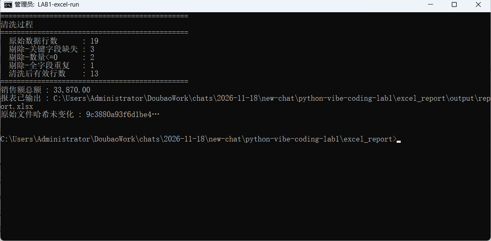
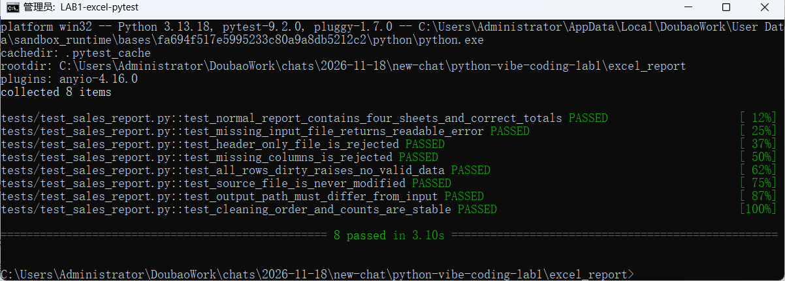
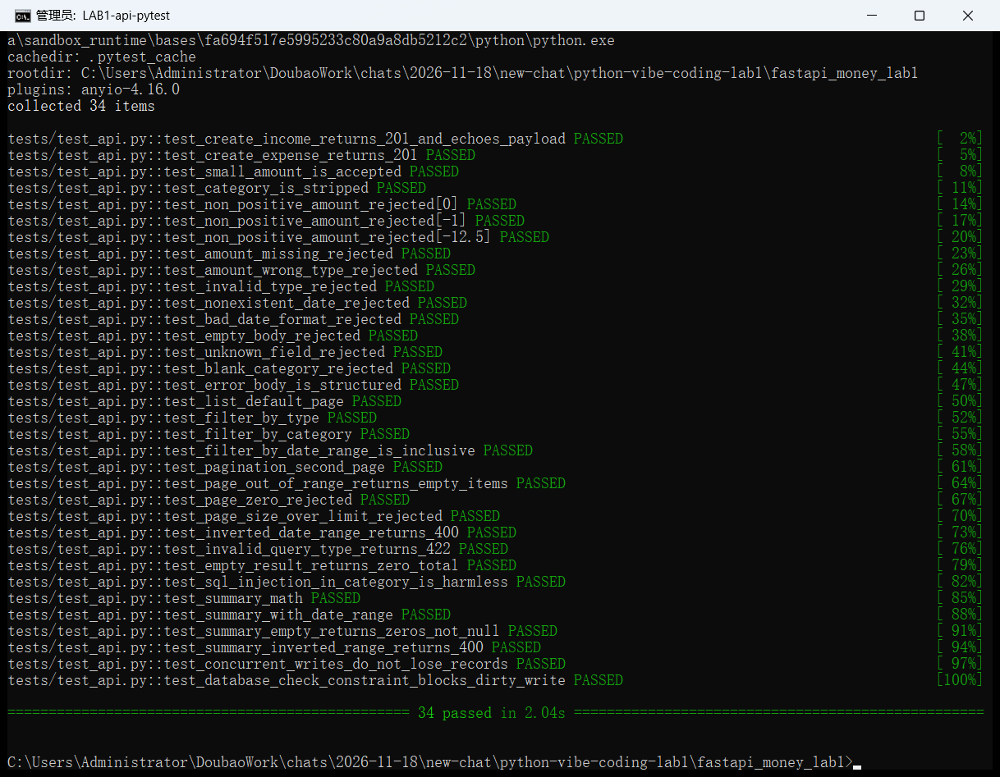
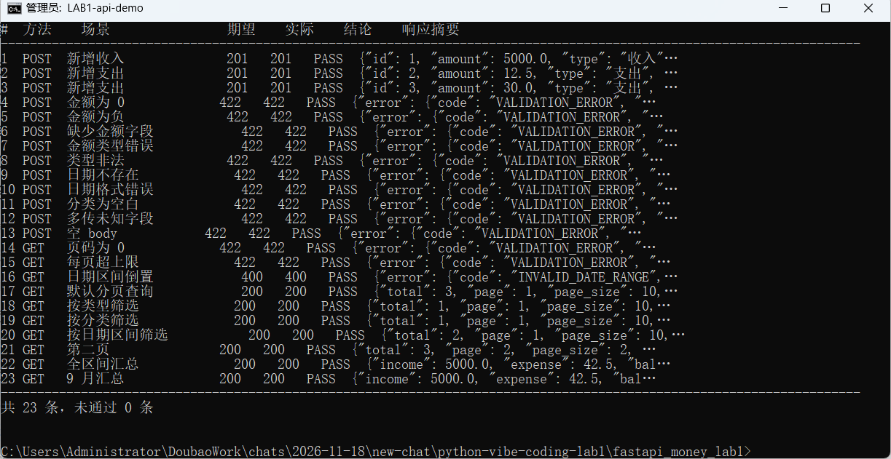
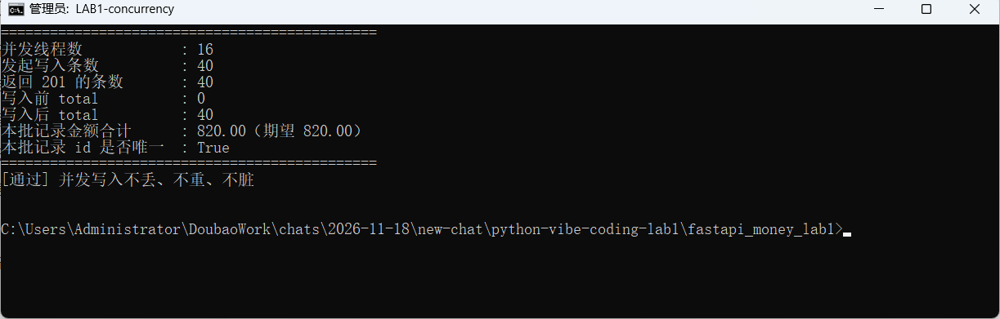

# 验证记录（可直接截图留档）

> 环境：Windows · Python 3.13.18 · pandas 3.1.1 · openpyxl 3.1.5 · fastapi 0.163.2 · pytest 9.2.0
> 以下全部是真实终端输出，可逐条复现。

## 零、真实运行截图

| 截图 | 说明 |
| --- | --- |
|  | 考题一：`python sales_report.py` 真实运行 |
|  | 考题一：8 个用例全部通过 |
|  | 考题二：34 个用例全部通过 |
|  | 考题二：23 条接口行为逐条比对 |
|  | 考题二：16 线程并发写 40 条 |

---

## 一、考题一：报表脚本运行输出

```text
$ python data/make_dirty_sample.py
已生成 ...\excel_report\data\sales_raw.xlsx，共 19 行（其中脏数据 6 行）

$ python sales_report.py
==============================================
清洗过程
==============================================
  原始数据行数      : 19
  剔除-关键字段缺失 : 3
  剔除-数量<=0      : 2
  剔除-全字段重复   : 1
清洗后有效行数    : 13
==============================================
销售额总额 : 33,870.00
报表已输出 : ...\excel_report\output\report.xlsx
原始文件哈希未变化 : 10390e6d6e50dda6…
```

### 输出报表（四张工作表）

**明细清洗后（13 行）**

| 日期 | 销售员 | 产品 | 数量 | 单价 | 地区 | 销售额 |
| --- | --- | --- | --- | --- | --- | --- |
| 2026-09-01 | 张三 | 笔记本 | 2 | 5000 | 华东 | 10000 |
| 2026-09-03 | 张三 | 鼠标 | 10 | 80 | 华南 | 800 |
| 2026-09-05 | 李四 | 显示器 | 3 | 1200 | 华南 | 3600 |
| 2026-09-08 | 李四 | 键盘 | 5 | 200 | 华南 | 1000 |
| 2026-09-10 | 王五 | 打印机 | 1 | 2500 | 华北 | 2500 |
| 2026-09-12 | 王五 | 墨盒 | 8 | 150 | 华北 | 1200 |
| 2026-09-15 | 赵六 | 笔记本 | 1 | 5000 | 西南 | 5000 |
| 2026-09-18 | 赵六 | 鼠标 | 4 | 80 | 西南 | 320 |
| 2026-09-20 | 张三 | 显示器 | 2 | 1200 | 华东 | 2400 |
| 2026-09-22 | 李四 | 打印机 | 2 | 2500 | 华南 | 5000 |
| 2026-09-25 | 王五 | 键盘 | 6 | 200 | 华北 | 1200 |
| 2026-09-26 | 赵六 | 键盘 | 2 | 200 | 西南 | 400 |
| 2026-09-28 | 赵六 | 墨盒 | 3 | 150 | 西南 | 450 |

**按销售员**

| 销售员 | 销售额 | 订单数 | 占比 |
| --- | --- | --- | --- |
| 张三 | 13200.00 | 3 | 38.97% |
| 李四 | 9600.00 | 3 | 28.34% |
| 赵六 | 6170.00 | 4 | 18.22% |
| 王五 | 4900.00 | 3 | 14.47% |
| 合计（4 个销售员） | 33870.00 | 13 | 100.00% |

**按地区**

| 地区 | 销售额 | 订单数 | 占比 |
| --- | --- | --- | --- |
| 华东 | 12400.00 | 2 | 36.61% |
| 华南 | 10400.00 | 4 | 30.71% |
| 西南 | 6170.00 | 4 | 18.22% |
| 华北 | 4900.00 | 3 | 14.47% |
| 合计（4 个地区） | 33870.00 | 13 | 100.00% |

**总览**

| 指标 | 数值 |
| --- | --- |
| 原始数据行数 | 19 |
| 剔除-关键字段缺失 | 3 |
| 剔除-数量<=0 | 2 |
| 剔除-全字段重复 | 1 |
| 剔除行数合计 | 6 |
| 脏数据占比 | 31.58% |
| 清洗后有效行数 | 13 |
| 参与统计的销售员数 | 4 |
| 参与统计的地区数 | 4 |
| 销售额总额 | 33870.00 |
| 客单价（总额/记录数） | 2605.38 |
| 销售额最高销售员 | 张三（13,200.00） |
| 销售额最高地区 | 华东（12,400.00） |
| 数据日期区间 | 2026-09-01 ~ 2026-09-28 |

### pytest（8 个用例）

```text
tests/test_sales_report.py::test_normal_report_contains_four_sheets_and_correct_totals PASSED [ 12%]
tests/test_sales_report.py::test_missing_input_file_returns_readable_error PASSED [ 25%]
tests/test_sales_report.py::test_header_only_file_is_rejected PASSED     [ 37%]
tests/test_sales_report.py::test_missing_columns_is_rejected PASSED      [ 50%]
tests/test_sales_report.py::test_all_rows_dirty_raises_no_valid_data PASSED [ 62%]
tests/test_sales_report.py::test_source_file_is_never_modified PASSED    [ 75%]
tests/test_sales_report.py::test_output_path_must_differ_from_input PASSED [ 87%]
tests/test_sales_report.py::test_cleaning_order_and_counts_are_stable PASSED [100%]

============================== 8 passed in 3.09s ==============================
```

---

## 二、考题二：接口实测（23 条，全部符合预期）

```text
$ python tools/api_demo.py --base-url http://127.0.0.1:8124
```

| # | 方法 | 场景 | 期望 | 实际 | 结论 |
| --- | --- | --- | --- | --- | --- |
| 1 | POST | 新增收入 | 201 | 201 | PASS |
| 2 | POST | 新增支出 | 201 | 201 | PASS |
| 3 | POST | 新增支出 | 201 | 201 | PASS |
| 4 | POST | 金额为 0 | 422 | 422 | PASS |
| 5 | POST | 金额为负 | 422 | 422 | PASS |
| 6 | POST | 缺少金额字段 | 422 | 422 | PASS |
| 7 | POST | 金额类型错误 | 422 | 422 | PASS |
| 8 | POST | 类型非法 | 422 | 422 | PASS |
| 9 | POST | 日期不存在（2026-02-30） | 422 | 422 | PASS |
| 10 | POST | 日期格式错误（2026/9/30） | 422 | 422 | PASS |
| 11 | POST | 分类为空白 | 422 | 422 | PASS |
| 12 | POST | 多传未知字段 | 422 | 422 | PASS |
| 13 | POST | 空 body | 422 | 422 | PASS |
| 14 | GET | 页码为 0 | 422 | 422 | PASS |
| 15 | GET | 每页超上限（101） | 422 | 422 | PASS |
| 16 | GET | 日期区间倒置 | 400 | 400 | PASS |
| 17 | GET | 默认分页查询 | 200 | 200 | PASS |
| 18 | GET | 按类型筛选 | 200 | 200 | PASS |
| 19 | GET | 按分类筛选 | 200 | 200 | PASS |
| 20 | GET | 按日期区间筛选 | 200 | 200 | PASS |
| 21 | GET | 第二页 | 200 | 200 | PASS |
| 22 | GET | 全区间汇总 | 200 | 200 | PASS |
| 23 | GET | 9 月区间汇总 | 200 | 200 | PASS |

```text
共 23 条，未通过 0 条
```

汇总响应实测：`{"income": 5000.0, "expense": 42.5, "balance": 4957.5}`

---

## 三、考题二：pytest（34 个用例）

```text
tests/test_api.py::test_create_income_returns_201_and_echoes_payload PASSED [  2%]
tests/test_api.py::test_create_expense_returns_201 PASSED                [  5%]
tests/test_api.py::test_small_amount_is_accepted PASSED                  [  8%]
tests/test_api.py::test_category_is_stripped PASSED                      [ 11%]
tests/test_api.py::test_non_positive_amount_rejected[0] PASSED           [ 14%]
tests/test_api.py::test_non_positive_amount_rejected[-1] PASSED          [ 17%]
tests/test_api.py::test_non_positive_amount_rejected[-12.5] PASSED       [ 20%]
tests/test_api.py::test_amount_missing_rejected PASSED                   [ 23%]
tests/test_api.py::test_amount_wrong_type_rejected PASSED                [ 26%]
tests/test_api.py::test_invalid_type_rejected PASSED                     [ 29%]
tests/test_api.py::test_nonexistent_date_rejected PASSED                 [ 32%]
tests/test_api.py::test_bad_date_format_rejected PASSED                  [ 35%]
tests/test_api.py::test_empty_body_rejected PASSED                       [ 38%]
tests/test_api.py::test_unknown_field_rejected PASSED                    [ 41%]
tests/test_api.py::test_blank_category_rejected PASSED                   [ 44%]
tests/test_api.py::test_error_body_is_structured PASSED                  [ 47%]
tests/test_api.py::test_list_default_page PASSED                         [ 50%]
tests/test_api.py::test_filter_by_type PASSED                            [ 53%]
tests/test_api.py::test_filter_by_category PASSED                        [ 56%]
tests/test_api.py::test_filter_by_date_range_is_inclusive PASSED         [ 59%]
tests/test_api.py::test_pagination_second_page PASSED                    [ 62%]
tests/test_api.py::test_page_out_of_range_returns_empty_items PASSED     [ 65%]
tests/test_api.py::test_page_zero_rejected PASSED                        [ 68%]
tests/test_api.py::test_page_size_over_limit_rejected PASSED             [ 71%]
tests/test_api.py::test_inverted_date_range_returns_400 PASSED           [ 74%]
tests/test_api.py::test_invalid_query_type_returns_422 PASSED            [ 77%]
tests/test_api.py::test_empty_result_returns_zero_total PASSED           [ 80%]
tests/test_api.py::test_sql_injection_in_category_is_harmless PASSED     [ 83%]
tests/test_api.py::test_summary_math PASSED                              [ 86%]
tests/test_api.py::test_summary_with_date_range PASSED                   [ 89%]
tests/test_api.py::test_summary_empty_returns_zeros_not_null PASSED      [ 92%]
tests/test_api.py::test_summary_inverted_range_returns_400 PASSED        [ 95%]
tests/test_api.py::test_concurrent_writes_do_not_lose_records PASSED     [ 98%]
tests/test_api.py::test_database_check_constraint_blocks_dirty_write PASSED [100%]

======================== 34 passed, 1 warning in 2.07s ========================
```

---

## 四、并发写入一致性验证

```text
$ python tools/concurrency_check.py --base-url http://127.0.0.1:8123 --count 40 --workers 16
==============================================
并发线程数            : 16
发起写入条数          : 40
返回 201 的条数       : 40
写入前 total          : 0
写入后 total          : 40
本批记录金额合计      : 820.00（期望 820.00）
本批记录 id 是否唯一  : True
==============================================
[通过] 并发写入不丢、不重、不脏
```

---

## 五、人工核对（Excel 报表金额）

- 张三：`2×5000 + 10×80 + 2×1200 = 13200` ✅
- 李四：`3×1200 + 5×200 + 2×2500 = 9600` ✅
- 赵六：`1×5000 + 4×80 + 2×200 + 3×150 = 6170` ✅
- 王五：`1×2500 + 8×150 + 6×200 = 4900` ✅
- 合计：`13200 + 9600 + 6170 + 4900 = 33870` ✅
- 按地区合计：`12400 + 10400 + 6170 + 4900 = 33870` ✅（与按销售员合计一致）

## 六、接口汇总人工核对

- 收入：`5000` → 5000.00 ✅
- 支出：`12.5 + 30` → 42.50 ✅
- 结余：`5000 - 42.5` → 4957.50 ✅
